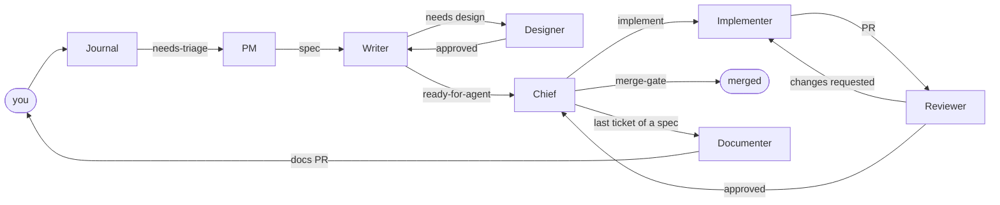

# Agents

One card per agent: the text that goes into the agent's instructions on [Tucano](https://tucano.sh). **Skills do the work and end in a named result. The card says what to do with each result.** Skills never mention agents, so the same skills work with any team layout.

## The team

Two channels:

- **`#planning`:** Journal, PM, Writer, Designer and Documenter, with you. Handoffs are direct (PM → Writer → Designer → Writer), because there is no decision to make between them.
- **`#pipeline`:** Chief, Implementer and Reviewer. The **Chief is the hub**: it picks the next ticket, calls the Implementer, receives the Reviewer's verdict and merges through the gate. **One thread per ticket**, so each agent reads only that ticket.

The tracker is the source of truth. Chat messages carry only pointers (`#83`, `PR #91`, a commit), which keeps them short and lets an agent resume after a session reset.



## Cards

| Agent | Skills | Card |
|---|---|---|
| Journal | `journal` | [journal.md](journal.md) |
| PM | `triage`, `grill-with-docs`, `research`, `to-spec` | [pm.md](pm.md) |
| Writer | `to-tickets` | [writer.md](writer.md) |
| Designer | `prototype` | [designer.md](designer.md) |
| Chief | `chief-of-staff`, `merge-gate`, `retro` | [chief.md](chief.md) |
| Implementer | `implement`, `tdd`, `diagnosing-bugs`, `pr`, `verify-app` | [implementer.md](implementer.md) |
| Reviewer | `code-review` | [reviewer.md](reviewer.md) |
| Documenter | `to-docs`, `domain-modeling` | [documenter.md](documenter.md) |

## Models

Each agent has a main model and a fallback from the other provider, which Tucano switches to when the main one fails or hits its limit. The Reviewer runs on the opposite provider from the Implementer, so the review brings a different view.

| Agent | Main | Fallback |
|---|---|---|
| Journal | Claude · Haiku 5.5 · high | Codex · gpt-5.6-luna · high |
| PM | Claude · Opus 5.5 · medium | Codex · gpt-5.6-sol · medium |
| Writer | Claude · Sonnet 5.5 · high | Codex · gpt-5.6-terra · high |
| Designer | Claude · Opus 5.5 · medium | Codex · gpt-5.6-sol · medium |
| Chief | Claude · Sonnet 5.5 · medium | Codex · gpt-5.6-sol · medium |
| Implementer | Claude · Opus 5.5 · medium | Codex · gpt-5.6-sol · medium |
| Reviewer | Codex · gpt-5.6-sol · medium | Claude · Opus 5.5 · medium |
| Documenter | Claude · Sonnet 5.5 · medium | Codex · gpt-5.6-terra · medium |

Start every effort at the level above and raise it only with evidence from `retro`. Set each agent's monthly limit and per-reply cap after the first week of use.

## Folders

Every agent that runs on "This computer" works **in its own folder** of the repo, one `git worktree` per agent, so no agent ever switches another's branch:

```bash
git worktree add --detach ../<repo>-implementer origin/<main branch>
```

Watch for ports: the Implementer and the Designer both start the app. If the project uses fixed ports, they can't run the app at the same time; use ports per folder or a turn rule.

## Card format

```markdown
# <Agent>

<Role in one sentence.>

## Tucano setup

- **Harness · model · effort:** ...
- **Fallback:** ...
- **Computer:** none | isolated Linux | This computer
- **Connectors:** GitHub (none | read | read_write), ...
- **Actions:** which run automatically, which are off
- **Channels:** #...
- **Skills enabled:** ...
- **Monthly limit · per-reply cap:** ...

## Instructions

You are the <Agent>. Use the skills <list>.

| Skill result | Next action |
|---|---|
| `<result>` | mention `@<agent>` in <where> with <pointer> |
| `<result>` | stop and call the human with <what> |

Messages carry only pointers (issue number, PR, commit). Outside the table, mention no one.
```
